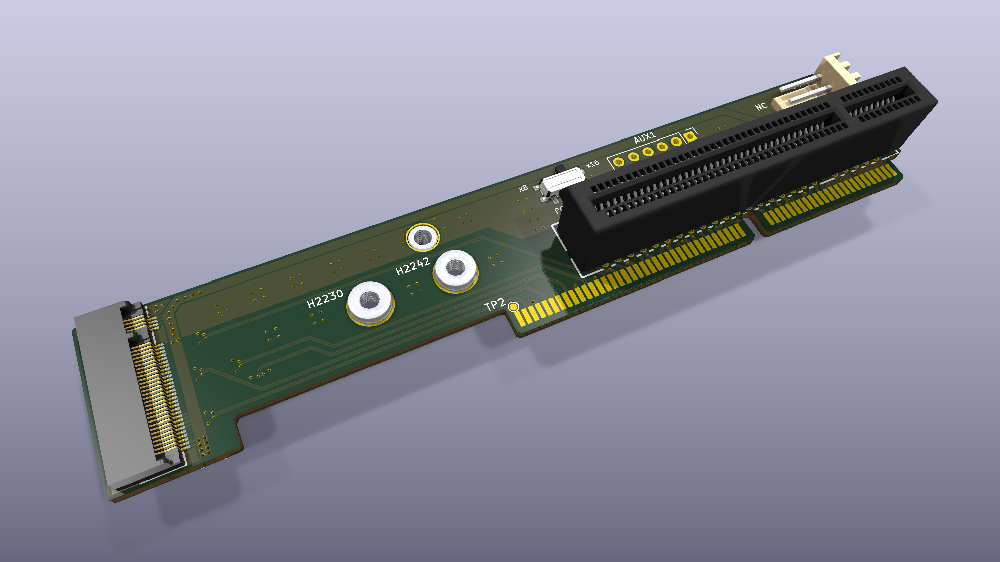
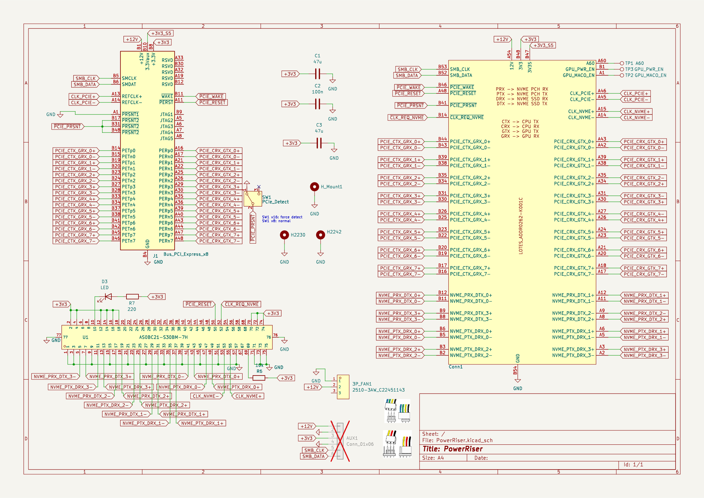

# PowerRiser – Lenovo Tiny 5 PCIe x8 + M.2 NVMe Riser (fork)

A passive riser for Lenovo Tiny 5 series PCs. It breaks the proprietary Lenovo riser connector out to an x8 PCIe slot and adds a 4-lane M.2 NVMe slot (2230/2242).

This is a modified fork of [nandfarm/PowerRiser](https://github.com/nandfarm/PowerRiser), which was inspired by [TinyRiser](https://github.com/a-little-wifi/Tinyriser) by WifiCable. See [Changes from upstream](#changes-from-upstream).

> ⚠ The changes in this fork have not been tested on hardware yet.

## Compatibility

Lenovo Tiny 5 series (8th/9th gen):

- ThinkCentre M720q
- ThinkCentre M920q
- ThinkCentre M920x
- ThinkStation P330 Tiny

It replaces the Lenovo risers with FRU codes 01AJ940, 01AJ902 and 01AJ929, and adds the M.2 slot. The back silkscreen also lists NEC Mate MC-3, MC-4 and MC-5.

The only physical change to the PC is removing the front metal bracket that holds the Bluetooth antenna.

## Usage & limitations

- **PCIe slot:** x8, closed at both ends as assembled. An x16 card fits only after you cut one end off the slot; see [Opening the slot for x16 cards](#opening-the-slot-for-x16-cards). It then runs at x8.
- **x16 cards:** slide the `PCIe CARD` switch (SW1) to **x16** or the card is not detected. SW1 is a small slide switch on the front, between the M.2 slot and the PCIe slot. The x16 position ties the slot's presence-detect line to GND. Leave it on **x8** for x1/x4/x8 cards. An x16 card's extra edge sits right over the M.2 drive, so check the clearance before you power on; see [Opening the slot for x16 cards](#opening-the-slot-for-x16-cards).
- **M.2 slot:** PCIe NVMe only, 2230 or 2242. SATA M.2 drives are not supported. Both drive lengths have a soldered M3 standoff; see [M.2 standoffs](#m2-standoffs).

## Pinouts

**AUX1** (left unpopulated; fit a 1×6 2.54 mm header if you need it. Pin 1 is the square pad):

| Pin | 1 | 2 | 3 | 4 | 5 | 6 |
|---|---|---|---|---|---|---|
| Signal | +12V | GND | +3.3V | GND | SMBCLK | SMBDATA |

**Fan header** (3-pin, 2.54 mm, keyed for a standard PC fan): GND, +12V, not connected. There is no tachometer or PWM signal, so 4-pin fans run at full speed.

**SW1 PCIe CARD** (C&K PCM12SMTR slide switch):

| Position | Contacts | Effect |
|---|---|---|
| x16 | 1–2 | Slot forced detected (needed for x16 cards) |
| x8 | 2–3 | No effect; x1/x4/x8 cards detect themselves |

## Changes from upstream

Compared with nandfarm/PowerRiser:

- **M.2 reset and clock request fixed.** `PERST#` and `CLKREQ#` were wired one pin early (pins 48 and 50 instead of 50 and 52), leaving the SSD's `CLKREQ#` unconnected. This matches the M.2 spec and TinyRiser now. It is the likely cause of the ASPM / L1 substate problems in the drive reports below.
- **x16 detect switch added.** SW1 `PCIe CARD`, an x16/x8 slide switch described above. The upstream files had no way to force detection.
- **AUX header reordered** so +12V is no longer next to +3.3V.
- **R1–R3 removed.** They were bypassed by copper and had no effect.
- **M.2 standoffs fitted at assembly.** Both standoff holes are in the BOM and placement file. Their drill is reduced from 4.4 mm to 4.3 mm to match the standoff datasheet (4.22 +0.08 mm), and their pads now have solder paste. The chassis screw post (H_Mount1) gets a 4 mm M3 SMT standoff on the bottom side, with paste on its pad.
- **Fan header moved up 1 mm.** It overlapped the end of the PCIe slot by about 0.4 mm. Its 12V feed and labels moved with it. Its holes are now 1.0 mm, as the 2510 datasheet asks (0.9 +0.1 mm).
- **Footprints checked against the datasheets.** The M.2 socket pads now match Foxconn's recommended layout, the PCIe slot's post holes are 2.35 mm, and slot pin A24 has a smaller pad so it clears the key notch by 0.2 mm.
- **JLC assembly files.** Every fitted part has an LCSC part number, including the PCIe slot, so the BOM and placement file cover the whole board.
- **3D models added** for the parts that had none, so the board renders complete.

## Building

Design files are in [`PowerRiser/`](PowerRiser) (KiCad 9).

PCB order settings (JLCPCB):

| Setting | Value |
|---|---|
| Layers | 4 |
| Thickness | 1.6 mm |
| Stackup | JLC04161H-3313, impedance control |
| Surface finish | ENIG |
| Gold fingers | Yes, 45° bevel |
| Copper | 1 oz outer, 0.5 oz inner |
| Vias | Tented |

Key parts:

| Part | MPN | LCSC |
|---|---|---|
| M.2 M-key socket (U1) | Foxconn AS0BC21-S30BM-7H | C2832351 |
| PCIe x8 slot, 98-pin (J1), closed end | UMAX 3183-10202P1T | C404115 |
| Fan header | 2510-3AW | C22451143 |
| x16/x8 slide switch (SW1) | C&K PCM12SMTR | C221841 |
| M.2 standoffs (H2230, H2242) | YIYUAN SMTSOM315BTR | C5221844 |
| Chassis screw post (H_Mount1, bottom side), M3 × 4 mm | YIYUAN SMTSOM340BTR | C5301786 |

For JLC assembly, the BOM and placement file cover every fitted part: J1, U1, the fan header, SW1, both M.2 standoffs, the chassis screw post, and the capacitors, resistors and LED. Choose standard PCBA with assembly on both sides, plus through-hole assembly for J1 and the fan header. AUX1 is left empty. Check the part rotations in JLC's placement preview before you confirm the order.

### Opening the slot for x16 cards

J1 is closed at both ends because no open-ended x8 slot that fits this footprint was in stock at JLC or LCSC when this was written. An x16 card needs one end of the slot cut off. The card then runs at x8.

1. Take the riser out of the PC and remove the M.2 drive.
2. Find the end of the slot furthest from the key. It is the end nearest SW1 and the M.2 slot. The x16 card's extra gold fingers come out here.
3. Cut straight down across the slot, from the top of the housing to the board, just past the last contact pair. Use a rotary tool (a Dremel or similar) with a thin cutting disc, or a fine hobby saw. The end block comes off in one piece. Keep the blade off the board surface.
4. Blow or brush the plastic dust out of the slot.
5. Slide SW1 to **x16**. Without this, the card is not detected.
6. Fit the M.2 drive, then the card, and check the clearance between them. The card's extra edge passes about 4 mm above the board, directly over the drive: over roughly the last 15 mm of a 2242 drive, or the last 4 mm of a 2230. Make sure the edge does not touch the drive, its parts or its label. An M.2 heatsink will not fit under the card.

Cut across the slot, not along the card channel. Cutting along the channel looks neater, but the disc is wide enough to damage the contacts. A cross cut removes more plastic and needs no precision.

*A good cut, shown on an x1 slot: cut along the lateral axis, across the slot. Photo by Marc Bevand, from [Tip to Use a Dremel to Cut Open a PCIe x1 Slot](https://blog.zorinaq.com/tip-to-use-a-dremel-to-cut-open-a-pcie-x1-slot/) (2011).*

### M.2 standoffs

JLC solders an SMTSOM315BTR standoff in both the 2230 and 2242 holes. It is an M3 surface-mount standoff, 1.5 mm tall, which matches the height of a drive in the M.2 socket.

- Fix the drive with an M3 × 3 mm pan-head screw in the standoff that matches its length. A 4 mm screw pokes slightly out of the bottom of the board.
- A 2242 drive passes over the 2230 standoff and touches it. The standoff is connected to GND. Check the underside of the drive at that point: if it has parts or bare pads there, put Kapton tape on top of the 2230 standoff. A drive with parts there may not sit flat.

## Drive reports (original nandfarm boards)

Collected by nandfarm from buyers of the original boards, before the M.2 fix above.

Reported OK:

- Crucial P310 2230 1TB
- Sabrent Rocket 2230 1TB (SB-2130-1TB)
- Kingston NV3 2230 (SNV3SM3/1T0)
- WD Black SN770M 2TB 2230
- Corsair MP600 Micro 2TB
- Intel DC P3605 1.6TB
- Micron 2400 Series MTFDKBK256TGE 256GB
- ADATA Legend 710 256GB
- Intel Optane M10 MEMPEK1J016GAH 16GB

Reported issues:

- SK Hynix PVC10 2230 1TB: not detected.
- SK Hynix BC711 2230 512GB: works only with ASPM off in the BIOS, or with the L1.1/L1.2 substates disabled in the OS.
- Micron 2400 Series MTFDKCD1T0QFM 1TB: detected at Windows startup, then disappears.

## License

CERN Open Hardware Licence v2 – Strongly Reciprocal ([CERN-OHL-S-2.0](LICENSE)).

This is a modified version of nandfarm/PowerRiser. The modifications are listed in [Changes from upstream](#changes-from-upstream) and were made in November 2026. Derived works must use the same licence. If you give or sell boards, tell recipients where the source is (this repository).

## Disclaimer

Use at your own risk. This design is provided for educational, experimental and hobbyist use, with no warranty. Check compatibility, power requirements and mechanical fit before installing.
